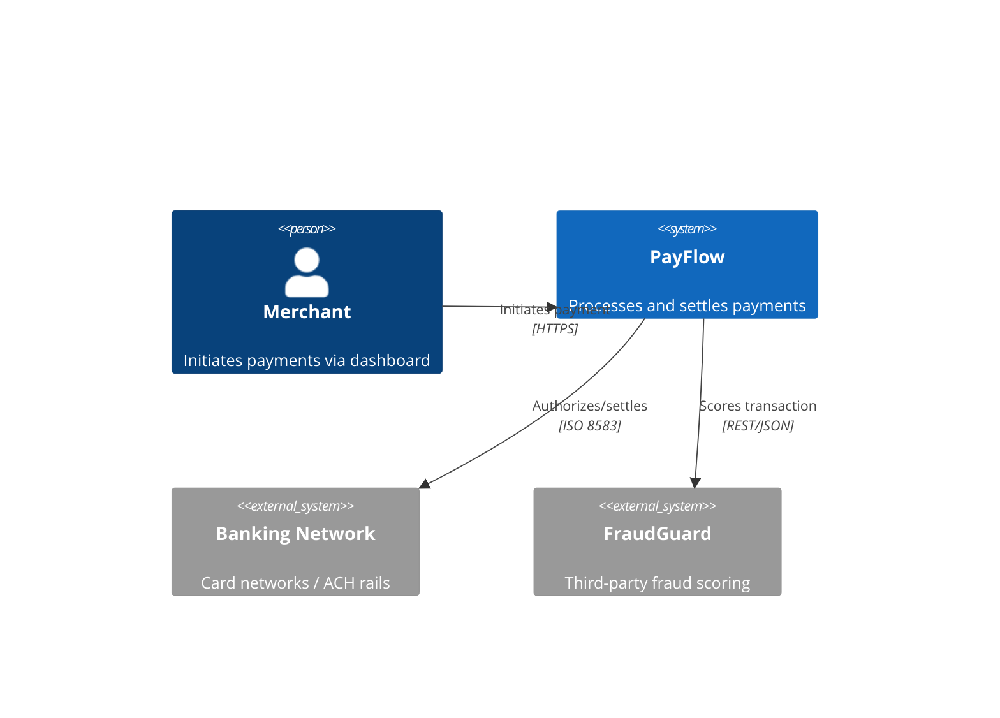

# C4 Model Diagramming

Draw architecture diagrams at exactly the zoom level the audience needs — System Context for scope and external actors, Container for the deployable pieces and how they talk, Component for the internals of one container, Code for a single class or module — instead of one overloaded diagram trying to answer every question at once.

## When to use this

- An existing architecture diagram tries to show the whole system, every database, every internal class, and every external integration on one page, and nobody outside the original author can read it.
- Onboarding a new engineer currently means a verbal walkthrough because there's no diagram at the right level to hand them.
- A design doc or ADR needs a diagram but the author defaults to a free-form box-and-arrow drawing with inconsistent notation, making it ambiguous whether a box is a service, a database, or a team.
- An architecture review board (`architecture-review-board-prep`) needs diagrams at a specific, comparable altitude across different teams' proposals.
- A system's structure has drifted from its last diagram and nobody trusts the diagram anymore (see `architecture-diagram-maintenance-workflow` for keeping it current).

## Workflow

1. **Start with Level 1: System Context.** Show your system as a single box, its human users/actors, and the other systems it talks to — no internal detail. This answers "what is this system, who uses it, what does it depend on" for a non-technical or cross-team audience. Pair with `system-context-diagram-authoring` for a deeper treatment of this level alone.
2. **Zoom to Level 2: Container.** Break the system box into its deployable/runnable units — web app, API service, worker, database, message queue — each labeled with its technology choice, and show the protocols between them (HTTPS/JSON, gRPC, AMQP). This is the most commonly useful level for engineers who need to understand the system's shape without reading code.
3. **Zoom to Level 3: Component only for containers that need it.** Break one specific container into its major internal components (controllers, services, repositories) and their relationships — don't produce a component diagram for every container; reserve it for the ones under active discussion or complex enough to need it.
4. **Skip Level 4: Code diagrams almost always.** These are UML class diagrams for a single component and are usually better generated on-demand by an IDE than hand-maintained — only produce one when explaining a specific, gnarly piece of logic (e.g., during a design review of a tricky class hierarchy).
5. **Pick one diagram tool and one notation and stick to it.** Structurizr, Mermaid C4 syntax, or PlantUML-C4 all support proper C4 notation with legends — avoid free-form drawing tools where box shape/color meaning is invented ad hoc per diagram.
6. **Label every relationship with what flows over it**, not just an arrow — "reads order status via REST," not an unlabeled line. An unlabeled arrow forces the reader to guess whether it's synchronous, async, or just a vague dependency.
7. **Keep a legend and consistent shape/color coding across all diagrams in the same set** — a database is always the same shape, an external system always the same color — so switching between Context and Container diagrams doesn't require relearning notation.
8. **Version diagrams as code (Mermaid/PlantUML text in the repo)**, not as an image pasted into a wiki — text-based diagrams get reviewed in the same PR as the code change that invalidates them, making staleness a review-time catch instead of a silent drift.
9. **State the diagram's audience and question at the top of the doc it lives in** — "this Container diagram answers: what are the deployable pieces of the Orders system and how do they talk" — so future editors know what to preserve when updating it.
10. **Cross-reference between levels** — the Container diagram's boxes should map cleanly onto the boxes inside the Context diagram, and a Component diagram should clearly say which Container box it's zooming into, so a reader can navigate up and down the hierarchy without getting lost.

## Example

Scenario: `PayFlow`, a payments platform, needs diagrams for a new engineer's onboarding doc and for an upcoming ADR about splitting the monolithic `payments-api` container.

Level 1 (Context, Mermaid C4):

Level 2 (Container, for `payflow`): boxes for `dashboard-web` (React SPA), `payments-api` (Java/Spring, REST), `settlement-worker` (Java, consumes Kafka), `payments-db` (PostgreSQL), `event-bus` (Kafka) — each labeled with technology, relationships labeled ("payments-api publishes PaymentAuthorized to event-bus").

Level 3 (Component, for `payments-api` only, produced specifically for the ADR): `AuthorizationController`, `FraudCheckService`, `PaymentRepository`, `SettlementEventPublisher` — showing that the proposed split separates `FraudCheckService` into its own container, which is exactly the change the ADR is proposing, making the "before" and "after" component diagrams the centerpiece of the decision doc.

## Common pitfalls

- **One diagram trying to show context, containers, and components all at once**, becoming unreadable and out of date the moment anything changes.
- **Producing Level 3/4 diagrams for every container "for completeness"** instead of only where the detail earns its place, burning maintenance effort on diagrams nobody reads.
- **Unlabeled arrows** that force the reader to guess protocol, direction, or synchronicity.
- **Inconsistent notation across diagrams** (a database drawn as a cylinder in one diagram and a rectangle in another) that makes the diagram set harder to read as a whole.
- **Diagrams as pasted images in a wiki**, invisible to code review and never updated when the architecture changes.
- **No stated audience/question**, so future editors don't know what level of detail to preserve versus prune when the diagram is updated.

## Output

A set of C4 diagrams as versioned text (Mermaid or PlantUML-C4, e.g., `docs/architecture/diagrams/context.mmd`, `container.mmd`, and per-container `component-<name>.mmd`), each with a legend, labeled relationships, and a one-line statement of the question it answers — checked into the repo alongside the code they describe.
