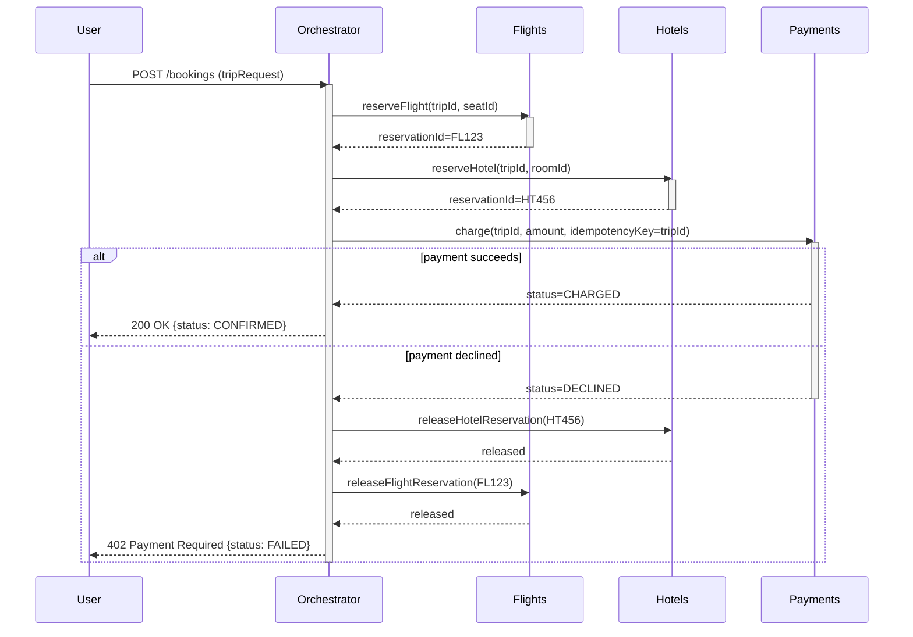

# Sequence Diagram Authoring

Model a specific interaction — a request flow, a saga, an event chain — as a sequence diagram that precisely shows which component calls which, in what order, synchronously or asynchronously, and what happens on the failure/alternative path, so the flow can be communicated and reasoned about without reading through scattered code across services.

## When to use this

- A multi-service interaction (an API call chain, a `saga-pattern-for-distributed-transactions` flow, an event-driven chain) needs to be documented or reviewed, and prose alone is ambiguous about order and timing.
- Onboarding a new engineer who needs to understand how a specific flow works across services without reading every service's code.
- Designing a new interaction before implementation, to catch ordering bugs, missing error handling, or an unnecessary synchronous call chain during design review rather than after coding.
- Debugging or documenting an incident where the actual sequence of calls diverged from the assumed one (`distributed-tracing-debugging` benefits from a diagram that states what should happen, for comparison).
- Preparing an `architecture-review-board-prep` package or an ADR that needs to show exactly how a decision plays out at the interaction level, not just the component level.

## Workflow

1. **Scope to one specific interaction, not a whole system** — a sequence diagram trying to show every possible flow through a system becomes unreadable; pick one scenario (e.g., "successful checkout," "checkout with payment failure") per diagram.
2. **List the participants (lifelines) first**: every actor, service, queue, or external system involved in this specific interaction, ordered left to right roughly by the flow's natural progression (initiator first, then downstream).
3. **Distinguish synchronous calls from asynchronous messages explicitly** — a solid arrowhead for a synchronous call awaiting a response, an open/dashed arrowhead for an async message (fire-and-forget or event publish) — this distinction is often the single most important thing the diagram needs to convey, since it determines blocking behavior and failure propagation.
4. **Show return/response arrows for synchronous calls** (dashed line back), including what's actually returned (not just "response") when the payload matters to understanding the flow.
5. **Model the happy path completely first**, then add at least one alternative/failure path using `alt`/`opt` fragments (or equivalent) — a diagram showing only the happy path hides exactly the failure-handling logic that's usually the hardest part to get right and the most valuable to review.
6. **Show activation bars (the lifeline's active-processing period)** where timing/duration matters — e.g., to make clear that Service A is blocked and waiting while Service B processes, which is often the detail that reveals an unnecessary synchronous dependency.
7. **Include timeouts and retries explicitly if they're part of the actual design** — an interaction with a 5-second timeout and up to 3 retries is meaningfully different from one with none, and hiding this detail hides real failure-mode behavior.
8. **Keep messages labeled with the actual operation name or event type**, not vague labels like "process" — a reader should be able to trace the label back to an actual method, endpoint, or event schema.
9. **Add a short prose note above or beside the diagram stating the scenario, preconditions, and postconditions** — a diagram without stated preconditions is ambiguous about what state the system is assumed to be in when the sequence starts.
10. **Keep the diagram in version control next to the code or design doc it documents**, as diagram-as-code (Mermaid or PlantUML) rather than an external tool's binary file, so it can be reviewed in a PR and stays discoverable.

## Example

Scenario: documenting the `TripBooker` saga's happy path and the payment-failure compensation path from `saga-pattern-for-distributed-transactions`, as a Mermaid sequence diagram for the design doc.

Prose note: "Preconditions: user is authenticated, flight and hotel availability already confirmed via prior search. Postconditions (success path): all three reservations confirmed, saga state=COMPLETED. Postconditions (failure path): both reservations released, saga state=FAILED, no charge applied. Payment call uses idempotency key = tripId; timeout 10s, no retry (declines are terminal, not retried by the orchestrator)."

This single diagram lets a reviewer immediately see: the payment call blocks the orchestrator (synchronous, solid arrows), compensation runs in reverse order of reservation, and the user gets a definitive response either way rather than being left in a pending state — details that would take several paragraphs of prose to convey unambiguously.

## Common pitfalls

- **Trying to show an entire system's interactions in one diagram**, producing something unreadable instead of the intended one clear scenario.
- **Not distinguishing sync from async calls**, hiding whether a caller is blocked and for how long — often the single most important architectural fact the diagram should convey.
- **Showing only the happy path**, omitting the failure/alternative handling that's usually the part most worth reviewing.
- **Vague message labels** ("process request") that can't be traced back to an actual method, endpoint, or event.
- **No stated preconditions/postconditions**, leaving the diagram's starting assumptions ambiguous to a new reader.
- **Diagrams as opaque binary files in a wiki**, disconnected from the code and design doc, drifting out of date silently since nobody reviews them in a PR.
- **Omitting timeouts/retries** that are actually part of the design, hiding real failure-mode timing from the reader.

## Output

A diagram-as-code sequence diagram (Mermaid or PlantUML) for one specific scenario, with participants, sync/async-distinguished messages, at least one alternative/failure path, and a short prose note stating scenario, preconditions, and postconditions — stored in version control alongside the design doc or code it documents.
