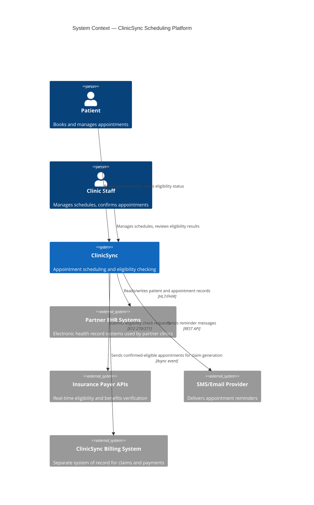

# System Context Diagram Authoring

Draw the highest-level view of a system — the system itself as a single box, the human actors and external systems around it, and the data/interaction flows between them — establishing what's inside the system's scope and what's external, so stakeholders share the same mental model of scope before deeper design conversations begin.

## When to use this

- A new project or major feature is starting and stakeholders (product, engineering, other teams) haven't yet agreed on what's in scope versus what's an external dependency.
- An architecture review board (`architecture-review-board-prep`) needs the simplest possible framing of "what is this system and what does it talk to" before diving into internal design.
- Onboarding a new engineer or stakeholder who needs the 30-second version of what a system does and who it interacts with, before any deeper diagram (`c4-model-diagramming`'s Container/Component levels) makes sense.
- A scope disagreement has surfaced (two teams assumed different boundaries for who owns what) and a shared, explicit diagram is needed to resolve it.
- This is the top level (Level 1) of the C4 model — use this skill specifically for that level; use `c4-model-diagramming` for the fuller Container/Component/Code levels beneath it.

## Workflow

1. **Draw the system as exactly one box**, no internal detail — a system context diagram's entire value is in staying at this altitude. If internal components are creeping in, that content belongs in a Container diagram instead.
2. **Identify every human actor** who interacts with the system directly (end users, admins, support staff, external partners' staff) — not user personas in the abstract, but roles that actually initiate interactions with this system.
3. **Identify every external system** the system integrates with — upstream systems it depends on, downstream systems that depend on it, and third-party services (payment processors, identity providers, external APIs) — each as its own box, at the same "black box, no internals" level of abstraction as the system under discussion.
4. **Draw one labeled relationship line per interaction**, stating what flows and in which direction — a label like "sends payment requests to" or "receives order events from" is far more useful than an unlabeled arrow or a vague "integrates with."
5. **Explicitly exclude internal implementation detail** — no databases, no internal services, no technology choices; if a reviewer asks "but how does it actually work inside," that's the cue to move to a Container-level diagram, not to add detail here.
6. **Keep actor and external-system count manageable** — if the diagram is accumulating 20+ boxes, consider whether some belong to a narrower-scoped context diagram for a specific subsystem, or whether some external integrations are genuinely out of scope for this particular discussion.
7. **Validate the boundary with stakeholders explicitly** — walk the diagram past whoever owns adjacent systems and confirm they agree what's inside versus outside; boundary disagreements are exactly what this diagram is meant to surface and resolve early.
8. **Note any deliberately excluded or deferred integration** as a callout rather than silently omitting it — a stakeholder wondering "why isn't X on this diagram" should find an explicit answer, not an unexplained gap.
9. **Keep it as diagram-as-code** (Mermaid, PlantUML, or a structured tool export) stored in the same repo/wiki as the deeper design docs it precedes, so it stays discoverable and versioned rather than living only in a slide deck.
10. **Revisit the diagram whenever the system's external integrations change** — a new third-party dependency, a deprecated integration, or a newly onboarded actor type should trigger an update, since a stale context diagram actively misleads new readers.

## Example

Scenario: `ClinicSync`, a healthcare scheduling platform, is starting a new project to add automated insurance eligibility checks, and the team needs to align on scope before designing the feature.

Callout note accompanying the diagram: "Billing/claims processing itself is explicitly out of scope for ClinicSync — it is a separate system (`ClinicSync Billing`) that ClinicSync notifies of eligibility results via an async event, and this project does not modify billing logic. This boundary was confirmed with the Billing team lead on 2026-09-02."

This resolved an actual disagreement during kickoff: the eligibility-check feature team had initially assumed they'd also need to update claim submission logic, which turned out to be Billing's responsibility — caught by walking this diagram past the Billing team before design work began.

## Common pitfalls

- **Letting internal components creep into the diagram** ("the API gateway," "the eligibility microservice"), collapsing the system-context altitude into a container-level diagram and losing the clarity a context diagram is meant to provide.
- **Unlabeled or vaguely-labeled relationship arrows**, leaving readers to guess what actually flows between systems.
- **Omitting an external system without explanation**, leaving stakeholders unsure whether it was forgotten or deliberately excluded.
- **Never validating the boundary with the owners of adjacent systems**, missing exactly the scope disagreement the diagram exists to surface.
- **Treating the diagram as a one-time artifact**, letting it go stale as integrations change and actively misleading new readers.
- **Overloading the diagram with 20+ boxes** trying to capture every possible integration, defeating its purpose as a quick, shared mental model.

## Output

A system context diagram (Mermaid C4Context, PlantUML, or equivalent) showing the system as one box, all human actors and external systems as labeled boxes at the same abstraction level, labeled relationship lines stating what flows and in which direction, and a short callout list of any deliberately excluded integrations — stored as diagram-as-code alongside the project's design docs.
