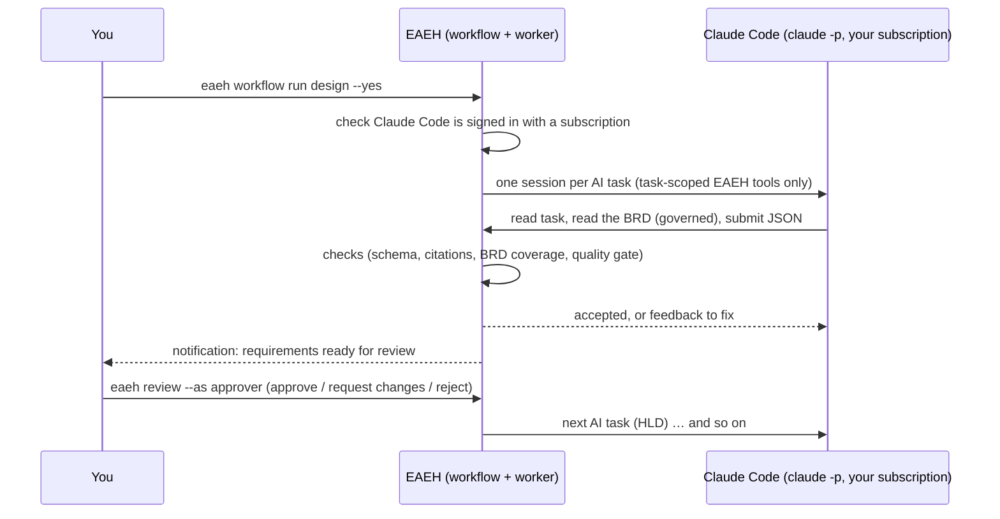

# Getting Started with EAEH

*A short, beginner-friendly guide. It reflects the implementation after the external AI execution enhancement (ADR-0025) and automated external AI execution (ADR-0026).*

In this guide:
- **Implemented** means the capability exists and is covered by automated tests.
- **Planned** means it belongs to a later phase and does not exist yet.

## 1. What is EAEH, and why does it exist?

The **Enterprise Architecture Engineering Harness (EAEH)** is a command-line tool and server. It lets AI do engineering work **under enterprise control**.

AI can draft requirements, designs and code quickly. Enterprises need more than speed:
- The output must follow company standards.
- Every statement must be traceable to its source.
- Sensitive data must not leak.
- A human must sign off before anything is used.

EAEH supplies those controls:
- AI *proposes*.
- Deterministic rules *check* every proposal.
- People *approve*.
- Everything is *recorded*.

## 2. Who does what: your AI assistant and EAEH

**Short version: your AI assistant thinks, and EAEH governs.**

| | Does |
|---|---|
| **Claude Code or GitHub Copilot** (your AI assistant) | The AI reasoning: reads the BRD, writes requirements, HLD and LLD, plans the implementation, writes code and tests. |
| **EAEH** | Everything around it: project registration, the knowledge your assistant may use, which skills and tools are allowed, the order of the steps, rule-based checks of every result, human approval gates, traceability and the audit trail. |
| **You and your colleagues** | Ask for the work, review the results and approve or request changes. Only people can approve. |

**Why your existing AI subscription does the reasoning.** You already pay for Claude Code or Copilot. EAEH does not need a second, separate AI subscription. In the default mode (`external_ai`), EAEH makes **no AI model calls** of its own. It hands each piece of AI work to your assistant and checks what comes back.

**You don't have to prompt the assistant for each step.** A background *worker* in EAEH runs every AI task automatically through the Claude Code CLI on your machine, signed in with your Claude subscription. You start a workflow once; EAEH runs it and stops only when a person has to approve something. The worker refuses to run if Claude Code is signed in with an API key, so this path never creates separate API charges.

**What EAEH adds that the assistant alone does not have:**
- **Governed context.** Approved standards, the BRD and approved skills are given to the assistant, with citations.
- **Fixed workflows.** For example BRD → requirements → HLD → LLD → implementation, with human approval gates between stages. EAEH moves from stage to stage on its own.
- **Deterministic checks.** Every result is checked before anyone sees it, for example "every Must requirement has acceptance criteria" or "every Must requirement is implemented and tested".
- **Permissions.** Each AI task may use only the tools its agent is allowed, for example only reading the BRD, or only writing files inside an isolated workspace.
- **Evidence.** Versioned artifacts, traceability links (BRD section → requirement → design → source file → test) and a tamper-evident audit log.

## 3. How the connection works (worker and MCP)

Claude Code and GitHub Copilot connect to EAEH through the **Model Context Protocol (MCP)**. That's a standard way for AI assistants to use external tools.

- `eaeh project init` writes two small files for each assistant. They contain no passwords or tokens:
  - **Claude Code:** `CLAUDE.md` and `.mcp.json`;
  - **GitHub Copilot in VS Code (agent mode):** `.github/copilot-instructions.md` and `.vscode/mcp.json`.
- The assistant starts `eaeh mcp` in the background. It acts as your *developer* identity, which EAEH stored once.
- The assistant gets EAEH tools such as:
  - `eaeh_readiness`;
  - `eaeh_activity_run`;
  - `eaeh_task_get` / `eaeh_task_submit` to receive and return AI work;
  - `eaeh_pending_approvals`.
- **There is no approval tool.** The assistant can show you the approval command, but cannot run it.

**Automated (normal) path.** EAEH's worker starts its own short Claude Code session (`claude -p`) for each AI task. That session gets only four EAEH tools, for that one task: read the task (including its exact result format and a valid example), call the agent's allowed tools, check a draft for free, submit the result. It has no shell, file or web access.

**Interactive path.** You can still open the project in Claude Code or Copilot and ask the assistant to do a task through the `eaeh_task_*` tools, for example when troubleshooting.

## 4. Getting a project ready

1. **Once, by an administrator:**
   - `eaeh init`;
   - `eaeh admin bootstrap …`;
   - `eaeh auth login --profile admin …`.
2. **In your repository, one command:** `eaeh project init --name … --brd BRD.md --developer … --steward … --approver …`. It:
   - registers the project and links your git repository;
   - records the technology stack;
   - creates the people and roles;
   - stores the BRD and knowledge;
   - registers the skills the workflows need;
   - writes the assistant files;
   - checks readiness.

   Running it again is safe.
3. **An approver reviews the skills:** `eaeh approval review --as approver`. EAEH uses a skill only after a human approves it.
4. **Check readiness:** `eaeh project readiness`. It says **READY** or **NOT READY**, and gives the exact command that fixes each problem. It also says whether automated execution is ready (Claude Code found and signed in with a subscription).
5. **Start work:** `eaeh workflow run design --yes`. The worker starts automatically. Follow progress with `eaeh workflow watch`; review with `eaeh review --as approver` when notified.

Full details, every command and troubleshooting are in the [Developer Experience Guide](DEVELOPER-EXPERIENCE-GUIDE.md).

## 5. The lifecycle

| Stage | Your assistant does (AI) | EAEH does (governance) | You do |
|---|---|---|---|
| BRD analysis and requirements | Reads the BRD through EAEH, writes requirements with acceptance criteria and BRD citations, flags ambiguities | Checks coverage of every BRD section, citations and measurability; renders `requirements.md` | Approve, request changes or reject |
| HLD | Designs components, interfaces, deployment, decisions and risks | Checks the design against requirements and mandatory standards; renders the HLD, ADRs and Mermaid diagrams | Approve / request changes / reject |
| LLD | Details modules, APIs, data, sequences and error handling | Checks it against the HLD and requirements; renders the LLD and diagrams | Approve / request changes / reject |
| Implementation plan | Splits the work into tasks, each with requirements, files and tests | Checks that every Must requirement is covered | Approve / request changes / reject |
| Implementation and tests | Writes code and tests **into an isolated EAEH workspace**, through EAEH's file tools | Checks that every Must requirement is implemented and tested and that the listed files exist; builds a source bundle with traceability; runs the build and tests in an isolated container (when configured) | Approve, then export the approved code into the repository |

In the table, "your assistant" means the worker's Claude Code sessions (or an assistant you prompt yourself).

Request changes sends your comments back automatically as a correction task (up to 3 rounds per gate); the earlier version and your comments are kept. A rejected run stops.

**If something goes wrong.** Each AI task is tried at most 3 times, with a growing pause between tries. Problems that a retry cannot fix stop the task at once: Claude Code not installed or not signed in, API-key sign-in, or your subscription's usage limit. The run then waits; `eaeh worker status` says why, and `eaeh worker retry <task>` continues after you fix it. If your machine restarts, the next `eaeh worker start` picks up where it stopped.

**Software development in more detail.**
- The code is written into an EAEH workspace, not straight into your repository.
- You approve a fingerprinted (hashed) bundle.
- `eaeh artifact export` copies exactly that approved version into your repository and reports whether it was approved.
- If your machine cannot run the build in isolation, a project can choose `--build-verification deferred`. EAEH then states clearly, in readiness and in the delivered bundle, that **it did not run the build or the tests**.

## 6. Execution modes and who pays

| Mode | Who does the AI work | What it costs | Use it for |
|---|---|---|---|
| `external_ai` (default) | Your Claude Code (automatically, through the worker) or Copilot (interactively) | Your existing subscription, under its own terms and usage limits. EAEH makes no model API calls and needs no AI key of its own. | Everyday work |
| `direct_provider` | EAEH calls an AI provider API itself | Separate API key and pay-per-use bill from that provider | Servers and automation without an IDE assistant |
| `deterministic` | Nobody: EAEH replays recorded answers | No AI cost; the output is **not AI-generated** | Tests and demos |

- **No hidden fallback.** In `external_ai` mode EAEH registers no AI provider at all, even if one is configured. The worker never switches to API billing or another provider.
- **Separate costs.** Running EAEH itself (your machine or server, storage, hosting) is a separate cost from AI usage in every mode.
- **No coverage guarantee.** We make no claim that any subscription covers unlimited usage. Automated runs use your plan's usage like any other Claude Code session. Each attempt is recorded (`eaeh worker history`), including Claude Code's own cost estimate, which is notional for a subscription login.

## 7. Governance in one paragraph

Roles keep duties separate:
- *developer* (operator) runs work;
- *approver* decides;
- *knowledge steward* curates knowledge;
- *administrator* sets up, but cannot run workflows or approve.

Anyone who submitted AI work cannot approve it. The worker runs as the developer, so it can never approve either. Each AI task may use only its agent's tools, under that agent's limits. Everything is recorded in a hash-chained audit log (`eaeh audit verify`).

## 8. What is not available yet

- **GitHub Copilot's cloud coding agent** (on github.com). It cannot reach a local EAEH. Copilot is supported in **VS Code agent mode**.
- **Parallel agents.** One worker per project runs one AI task at a time.
- **Automating GitHub Copilot.** Only Claude Code can be run by the worker; Copilot is supported interactively in VS Code.
- **Running without your machine.** The worker runs locally, while your machine is on and Claude Code is signed in.
- **Release and deployment** (Phase 7), and **a web interface**: EAEH has a CLI, MCP and an HTTP API.
- **HTTP API equivalents** of the newest developer commands (`task`, `project`, `auth`).
- **Enforcement outside EAEH.** EAEH cannot stop an assistant from editing files directly if you ask it to. The generated instructions tell it not to.
- **A full live run with a GitHub Copilot session.** The Copilot configuration is tested only at the protocol level (see the [completion report](../implementation/EXTERNAL-AI-EXECUTION-AND-DEX-IMPROVEMENTS.md)).
- **A completed automated run with the real Claude Code.** The worker is covered by automated tests (with a stand-in AI client) and by real `claude -p` probe sessions; the full `simple-springboot-api` run is in progress.

More detail: [User Manual](EAEH-USER-MANUAL.md), [Quick Start](QUICKSTART-HLD-LLD.md), [architecture overview](../architecture/README.md), [ADR-0025](../architecture/adr/ADR-0025-external-ai-execution-mode.md), [roadmap](../implementation/ROADMAP.md), [action register](../implementation/ACTION-ITEMS.md).
